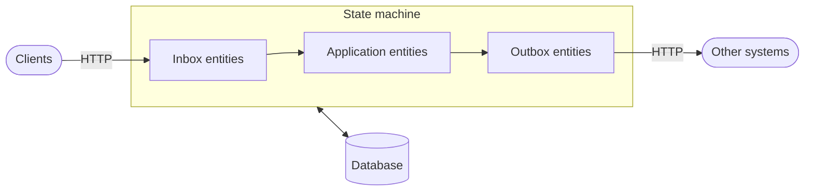
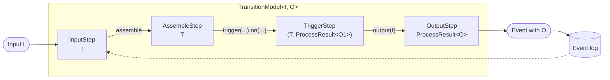
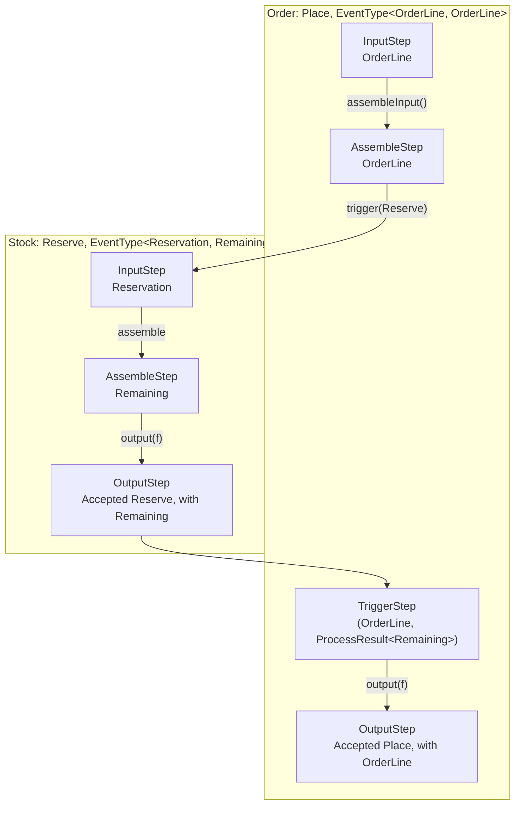
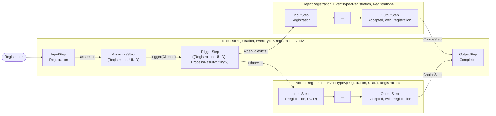

# Architecture

An application built with the server is a set of entity models, each a finite state machine, given to a
`StateMachine`. The state machine stores the entities as event logs in a database.

The application receives requests through HTTP inboxes and sends requests to other systems through HTTP outboxes.
They are state machines with entities too, given to the `StateMachine` along with the entity models of the
application. Every request received or sent is an entity with a state and an event log of its own. It is stored in the
same database and the same transactions as the entities of the application it belongs to. The state machine doesn't
treat a request any differently from a payment or an order.

Everything is reactive, built on [Reactor](https://projectreactor.io), and no state is kept in memory between
requests, so any number of instances can serve the same database.



## Modules

| Module                                                                | Contains                                                                                       |
|-----------------------------------------------------------------------|------------------------------------------------------------------------------------------------|
| core                                                                  | The state machine, the builder of transition models, and the interface of the databases        |
| [database-mssql, database-pgsql-*](databases.md)                      | The SQL of a database and the driver it is reached through, one module per database and driver |
| http-inbox                                                            | Inboxes: entity models receiving HTTP requests and routing them to the entities of an application |
| http-outbox                                                           | Outboxes: entity models sending HTTP requests at least once or at most once                    |
| [test-api](testing.md)                                                | An API for tests to look into and manipulate the database of a state machine                   |
| diagram                                                               | State diagrams and ER diagrams of a state machine's model                                      |
| [templates](cardpayments.md)                                          | Ready-made entity models of a domain, such as card payments                                    |

An application depends on core, the database module of its database, and http-inbox and http-outbox if it receives or
sends HTTP requests. See the [apps](apps.md) for complete applications.

## Entities

An entity model has a set of states, and transitions between them on event types. An entity is an instance of an
entity model, identified by a UUID. Its events are stored in its event log, and its current state is the state its
events lead to from the initial state `Begin`. The event logs are the source of truth; see the
[data model](data-model.md).

The transitions of an entity model are declared with `TransitionModelBuilder`. A transition is taken on an event of a
type, assembles data from the event and the entity's event log, and can trigger events on other entities:

```java
onEvent(Greet).to(States.Greeted)
    .assemble(c -> c.log().entityId().toString())
    .trigger(RespondGreeting).with(id -> id).on(RequestDispatching).identifiedBy(entityIdFromSession())
    .output()
```

The entity an event is triggered on is selected by an `EntitySelector`: by its entity id, as a new entity, by an id it
has, or as the last one of a group it is indexed in. The ids and index keys of entities are events of their own, of
id entity models (`IdEntityModel`) and index entity models (`IndexEntityModel`). An id is unique among the ids of its
type, so an event claiming an id that is taken is rejected.

## Processing an event

An event enters the state machine through `StateMachine.onEvent`, from the HTTP inbox or from the application itself.
The state machine reads the event log of the selected entity, finds the transition from its current state on the
event's type, and follows the triggers of the transition from entity to entity. The new events of all the entities
involved are stored in one transaction, together with the triggers to be fired later. If another instance has
appended an event to one of the entities in the meantime, the transaction fails on the event number, and the event is
retried on the new event log.

A transition has four kinds of triggers:

* **Event triggers** trigger an event on another entity, in the same transaction.
* **Delayed triggers** (`.after(delay)`) trigger an event on the entity after a delay, unless it has received another
  event first. They are stored in the database and fired by a worker of every state machine instance. Timeouts and
  retries are built from them.
* **Conditional triggers** trigger an event when the last event of every referenced entity is one of the given types,
  e.g. when all the requests of a batch are completed. They are also fired by a worker.
* **Actions** are side effects outside the database, such as sending an HTTP request. They are run after the
  transaction is committed, and their outcome is fed back to the entity as a new event.

Since side effects only happen after the events causing them are stored, an entity always knows what it has started.
If the instance stops before an action completes, a delayed trigger stored with the action, such as the timeout of an
outbox request, moves the entity on.

## Transition models and steps

### Input and output of an event type

An event type has two type parameters, `EventType<I, O>`, and so does the transition model of a transition on it,
`TransitionModel<I, O>`:

* **`I`, the input**, is the data an event of the type is triggered with: by `with(...)` of the transition triggering
  it, by the caller of `StateMachine.onEvent`, or by a delayed or conditional trigger, which stores it until the
  trigger fires. The transition calculates its event from it.
* **`O`, the output**, is the data of the event the transition stores in the entity's event log. `output(f)` calculates
  it from the data of the last step, and `output()` stores the event without data. The output is also what a
  transition triggering the event gets back.

`BasicEventType.of(name, id, dataType)` gives an event type whose input and output are the same, and
`BasicEventType.of(name, id)` one with neither (`Void`). The [identity provider](identity-provider.md) has event types
of all kinds:

| Event type            | `I`                    | `O`            |
|-----------------------|------------------------|----------------|
| `Register`            | `Registration`         | `Registration` |
| `RequestRegistration` | `Registration`         | `Void`         |
| `AcceptRegistration`  | `(Registration, UUID)` | `Registration` |
| `ClientId`            | `String`               | `String`       |

### Steps

`TransitionModelBuilder` builds the transition model. It starts with `onEvent(type).to(state)`, every call after it,
such as `assemble`, `trigger` or `when`, adds a step, and `output()` ends it with the model.

When an event enters an entity, the model calculates the steps of the transition one by one, each from the one before
it. A step is a `TransitionStep<T>`, where `T` is its output: the data the next step is calculated from. The chain
starts with an `InputStep`, whose output is the input `I`, and ends with an `OutputStep`, whose output is the result of
the transition, a `ProcessResult<O>` with the new event if it is accepted. The steps in between turn one into the
other:



The input step also has what the other steps need besides the data: the entity's event log, its current state, the
timestamp, and the `Calculation` the step is part of. The output of each step is:

| Step                     | Added by                      | Output                                                                                        |
|--------------------------|-------------------------------|-----------------------------------------------------------------------------------------------|
| `InputStep`              | The event entering the entity | The input `I`                                                                                 |
| `AssembleStep`           | `assemble`                    | What the assembler makes of the input and the event log                                       |
| `TriggerStep`            | `trigger(...).on(...)`        | The output of the step before it, paired with the `ProcessResult<O1>` of the event triggered  |
| `DelayedTriggerStep`     | `trigger(...).after(...)`     | The output of the step before it. The step has the delayed event to store                     |
| `ConditionalTriggerStep` | `trigger(...).when(...)`      | The output of the step before it. The step has the conditional trigger to store               |
| `ActionStep`             | `trigger(action)`             | The output of the step before it. The step has the action to run after the changes are stored |
| `ChoiceStep`             | `when(...).then(...)`         | The output of the step before it, after the steps of the chosen transition                    |
| `OutputStep`             | `output`                      | The `ProcessResult<O>` of the transition                                                      |

### Triggering an event on another entity

An event triggered on another entity continues the chain into the transition of that entity. The data of the trigger,
`with(...)`, is the input `I1` of the triggered event type, and becomes the output of the `InputStep` of the triggered
transition. Its steps follow up to its `OutputStep`, whose `ProcessResult<O1>` the `TriggerStep` pairs with the data
it had before the trigger, and the chain goes on in the triggering transition.

An order reserving the items of an order line from their stock shows how the data goes from one entity to the
other. `Place` takes the order line as input and stores it as output, and `Reserve` takes the quantity to reserve as
input and stores the quantity left in stock as output:

```java
record OrderLine(UUID item, int quantity) {}
record Reservation(int quantity) {}
record Remaining(int quantity) {}

EventType<OrderLine, OrderLine> Place = BasicEventType.of("Place", placeId, DataType.json(OrderLine.class));
EventType<Reservation, Remaining> Reserve = BasicEventType.of(
    "Reserve",
    reserveId,
    DataType.json(Reservation.class),
    DataType.json(Remaining.class)
);
```

The transition of the order triggers `Reserve` on the stock of the item, and the transition of the stock calculates
the quantity left from its event log:

```java
onEvent(Place).to(OrderStates.Placed)
    .assembleInput()
    .trigger(Reserve).with(line -> new Reservation(line.quantity())).on(Stock).identifiedBy(line -> entityId(line.item()))
    .output(d -> d.t1())

onEvent(Reserve).toSelf()
    .assemble((reservation, log) -> new Remaining(remaining(log) - reservation.quantity()))
    .output(remaining -> remaining)
```



Every step refers to the one before it, `previous`, so the steps of both transitions are stacked in one chain, with
the steps of the triggered transition nested between the step triggering it and the `TriggerStep`. Below, the first
step is on top, every step refers to the one above it, and the result of the calculation is the step at the bottom:

<div class="step-stack">
  <div class="step-stack-title">Order: Place</div>
  <div class="step"><code>Input</code><span>OrderLine</span></div>
  <div class="step"><code>Assemble</code><span>OrderLine</span></div>
  <div class="step-stack">
    <div class="step-stack-title">Stock: Reserve</div>
    <div class="step"><code>Input</code><span>Reservation</span></div>
    <div class="step"><code>Assemble</code><span>Remaining</span></div>
    <div class="step"><code>Output</code><span>ProcessResult&lt;Remaining&gt;</span></div>
  </div>
  <div class="step"><code>Trigger</code><span>(OrderLine, ProcessResult&lt;Remaining&gt;)</span></div>
  <div class="step"><code>Output</code><span>ProcessResult&lt;OrderLine&gt;</span></div>
</div>

The `TriggerStep` also refers to the step before the trigger, `outer`, here the `AssembleStep` of `Place`, whose
output it pairs with the result of the triggered event. A step finds the `InputStep` of its own transition, with the
event log and the timestamp, by skipping over the nested transitions, from their `OutputStep` back to their
`InputStep`.

A triggered event isn't always accepted. Instead of an `OutputStep`, the triggered transition can then end with one
of these, whose `ProcessResult` the triggering transition can act on, e.g. with `when(...)`:

| Step            | When                                                                                |
|-----------------|-------------------------------------------------------------------------------------|
| `RejectedStep`  | The event is rejected, e.g. since the entity has no transition on it from its state |
| `UnknownIdStep` | The entity of the event is not found                                                |
| `PendingStep`   | The event is circular, i.e. on an entity already changed by the calculation         |
| `IdExistsStep`  | The id of an id event is held by another entity (see [existing ids](#existing-ids)) |

### Choosing a transition

`when(predicate).then(model, f)` chooses another transition of the same entity, if the predicate holds for the
output of the step before it. `f` gives the input of the chosen transition's event type, and the steps of the chosen
transition follow, in the chain, up to its `OutputStep`. `otherwise(model, f)` ends the transition with the
transition chosen if no other one was. The event of the chosen transition is then the event stored; the output of the
transition itself is a `Completed` result referring to it.

The identity provider registers a client by `RequestRegistration`, whose output is `Void`, and the event stored is
either `RejectRegistration` or `AcceptRegistration`, depending on whether the client id is taken:



### Collecting the changes

When the calculation is done, the changes to store, i.e. the accepted events, the delayed events and the conditional
triggers, and the actions to run, are collected by following the chain back from its last step to its first. In the
order above, that gives the `Place` and `Reserve` events.

Every step is taken through the `Calculation` of the event, which records the result of the step. That makes it
possible to calculate the changes again from a step in the middle of the chain, without executing the steps before it
again, such as an assembler reading from another system.

## Existing ids

An id event claims an id for an entity, and is unique among the events of its type (see the
[data model](data-model.md#idevent)). Whether the id is taken can't be known for certain until the changes
are stored, since another instance can claim it in the meantime. The state machine therefore calculates the changes as
if the id were free, and stores them. If an id is found to be taken, the database rejects the transaction on the
unique index, and the state machine

1. reads the event log of the entity holding the id,
2. tells the `Calculation` that the id exists, and
3. calculates the changes again, from the step triggering the id.

The steps before the trigger are not executed again, but get the results recorded for them, so the calculation of the
changes doesn't start over. When the id event is triggered again, its result is an `IdExistsStep`, with the entity
holding the id, instead of the event being accepted. The `ProcessResult` of the trigger is then `IdExists`, which the
transition can act on. The [identity provider](identity-provider.md) rejects the registration of a client whose id is
taken this way:

```java
onEvent(RequestRegistration).to(States.Accepted)
    .assemble(c -> tuple(c.input(), UUID.randomUUID()))
    .trigger(ClientId).with(d -> d.t1().clientId()).on(ClientIds).identifiedBy(d -> entityId(d.t2(), AlwaysCreate))
    .when(d -> d.t2().isIdExists()).then(rejectRegistration, d -> d.t1().t1())
    .otherwise(acceptRegistration, d -> d.t1())
```

If a step before the trigger was rejected, all the steps are executed again, since whether a rejection is handled is
decided by the steps after it. The changes are not calculated again if the id is not triggered by any step, or if it
is found to exist even after they were calculated with it existing; the event then fails.

## HTTP inboxes

An inbox is a set of entity models whose entities are the requests the application receives. Their transitions are
given to the state machine along with those of the application, and the inbox is drawn in the same kind of state
diagram (see [RequestRouting](images/com.github.thxmasj.backend.http.inbox.RequestRouting.svg) and
[RequestDispatching](images/com.github.thxmasj.backend.http.inbox.RequestDispatching.svg)).

The `HttpInboxListener` receives HTTP requests with reactor-netty and passes them to the entity models of the inbox.
A `RequestRouting` entity is created for every request, and matches it against the routes of the application. A route
validates the request, and gives the event type and entity it triggers. A `RequestDispatching` entity is created for
every routed request, which triggers the event on the application's entity and waits for it to respond. The response
is an event on the `RequestDispatching` entity, of a `ResponseEventType`, which the listener sends to the client.

Requests carrying a message id are deduplicated through the `MessageIds` id entity model: a retried request gets the
response of the first one, without triggering anything again. Filters on the listener can authenticate, log or rewrite
requests before they reach the inbox.

### Access tokens

Routes requiring an access token, e.g. one issued by the [identity provider](identity-provider.md), take
`HttpInbox.bearerToken(verifier, scopes...)` as their authorizer, which authorizes the `sub` of the bearer token if the
verifier finds it valid and it has the scopes. The `AccessTokenVerifier` is given the keys of the issuer, its issuer
URI and optionally the audience the tokens must have:

```java
var verifier = AccessTokenVerifier.fetchingKeys(
    URI.create("https://idp.example.com/.well-known/jwks.json"),
    URI.create("https://idp.example.com"),
    "payments-api",
    Clock.systemUTC()
);
var authorizer = HttpInbox.bearerToken(verifier, "payments");
```

The verifier accepts JWT access tokens as profiled by [RFC 9068](https://www.rfc-editor.org/rfc/rfc9068): of type
`at+jwt`, signed with RS256 by a key of the issuer, of the issuer, not expired, for the audience if one is given, and
with the claims `sub` and `client_id`. A refused request is answered as
[RFC 6750](https://www.rfc-editor.org/rfc/rfc6750#section-3) says, with a `WWW-Authenticate` header: 401 and the
challenge `Bearer` without a bearer token, 401 and the error `invalid_token` with a token that is invalid or expired,
and 403 and the error `insufficient_scope` with a token lacking a scope. An authorizer returns an `Authorization`,
either `Authorized` with the subject or `Refused` with the status code, challenge and reason of the response;
`Authorization.refused(reason)` refuses with 400. The keys are fetched once, so the verifier must be created again to see keys the
issuer has added since.

## HTTP outboxes

An application has an outbox for each kind of request it sends to other systems, e.g. one for authorisations and one
for captures. Each outbox is an entity model whose entities are the requests sent, and its state diagram tells how a
request goes from dispatched to accepted, rejected, retried or rolled back (see
[AtLeastOnce](images/com.github.thxmasj.backend.http.outbox.AtLeastOnce.svg) and
[AtMostOnce](images/com.github.thxmasj.backend.http.outbox.AtMostOnce.svg)).

A request's entity is created by a transition of the application, through a dispatcher, so the request is stored before it is sent, and is sent by an
action after the transaction is committed. The response is fed back as an event, and the outbox request triggers an
event on the entity which dispatched it. A request without a response times out by a delayed trigger stored when it
was dispatched.

* `AtLeastOnce` resends the request after a backoff, by delayed triggers, until it gets a response or its attempts
  run out. The receiver must therefore tolerate duplicates.
* `AtMostOnce` sends the request once. It can be rolled back, whether it was accepted or its outcome is unknown, e.g.
  after a timeout, by a rollback request, which is itself an `AtLeastOnce` request.

Requests of both kinds can be sent in batches.

## Diagrams

The diagram module draws the state diagram of an entity model with PlantUML, and an ER diagram of a state machine's
complete model, where the entity models are related through the triggers of their transitions. The diagrams of the
[card payment template](cardpayments.md) are generated this way when the documentation is built.
