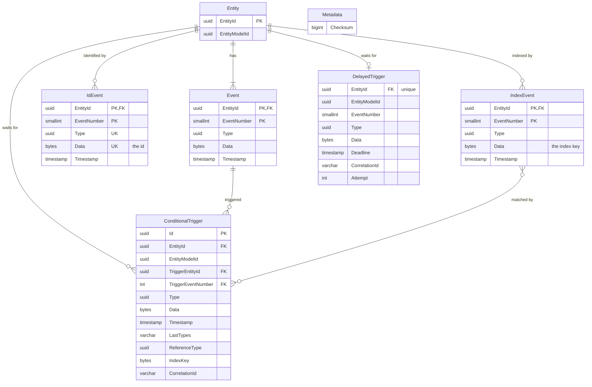

# Data model

The state machine stores everything in a single database schema, which it creates on startup (see
[Schema creation](schema-creation.md)). Entities are event sourced: the current state of an entity is derived by
replaying its events, so the event logs are the source of truth and the other tables hold pending work.

The diagram gives the types in general terms; see each table below for the types on each database. The relationships
are logical only; the schema declares no foreign key constraints. All changes caused by a single input event (new
events, delayed triggers and conditional triggers, possibly on several entities) are written in one transaction.

## Tables

The tables and columns are the same on each database, with the types given for each table below. All columns are
`NOT NULL`, except the `Data` columns of `Event`, `DelayedTrigger` and `ConditionalTrigger`.

### Metadata

A single row with a checksum of the table definitions. On startup the checksum is compared with that of the running
code's table definitions, and startup fails if they differ, as the schema is never migrated automatically.

| Column   | SQL Server | PostgreSQL |
|----------|------------|------------|
| Checksum | `BIGINT`   | `BIGINT`   |

### Entity

One row per entity, inserted together with the entity's first event. `EntityModelId` is the id of the entity model the
entity is an instance of, which determines its states and transitions. Id and index entities (see below) have no row
here.

| Column        | SQL Server         | PostgreSQL |
|---------------|--------------------|------------|
| EntityId      | `UNIQUEIDENTIFIER` | `UUID`     |
| EntityModelId | `UNIQUEIDENTIFIER` | `UUID`     |

### Event

The event logs of entities. Each event belongs to an entity and is numbered from 1 within it, so the primary key
`(EntityId, EventNumber)` also guards against concurrent changes to the same entity: two transitions computed from the
same state both try to insert the same event number, and only one of them succeeds.

`Type` is the id of the event type, and `Data` is the event's data as marshalled by the event type's data type.

| Column      | SQL Server         | PostgreSQL  |
|-------------|--------------------|-------------|
| EntityId    | `UNIQUEIDENTIFIER` | `UUID`      |
| EventNumber | `SMALLINT`         | `SMALLINT`  |
| Type        | `UNIQUEIDENTIFIER` | `UUID`      |
| Data        | `VARBINARY(MAX)`   | `BYTEA`     |
| Timestamp   | `DATETIME2`        | `TIMESTAMP` |

### IdEvent

The event logs of id entities (`IdEntityModel`), which hold the ids of entities other than their entity ids, such as a
merchant id. An id entity shares its entity id with the entity it identifies, and each of its events is an id: `Type`
is the kind of id and `Data` its marshalled value. Id events are triggered from transitions like any other event.

The pair `(Type, Data)` is unique, so an id refers to at most one entity, and an entity is found by its id with a single
index lookup (`EventsByIdEvent`). If two transitions add the same id concurrently, one of them fails on the unique
index, and its changes are computed again with the entity that got the id, from the step that added the id.

`Data` is limited to 1684 bytes, leaving room for `Type` in the 1700 bytes SQL Server allows for an index key.
PostgreSQL has no such limit in the schema, but its B-tree indexes take keys of at most about 2700 bytes.

| Column      | SQL Server         | PostgreSQL  |
|-------------|--------------------|-------------|
| EntityId    | `UNIQUEIDENTIFIER` | `UUID`      |
| EventNumber | `SMALLINT`         | `SMALLINT`  |
| Type        | `UNIQUEIDENTIFIER` | `UUID`      |
| Data        | `VARBINARY(1684)`  | `BYTEA`     |
| Timestamp   | `DATETIME2`        | `TIMESTAMP` |

### IndexEvent

The event logs of index entities (`IndexEntityModel`). Like an id entity, an index entity shares its entity id with the
entity it indexes, but its events need not be unique: `Data` is an index key, such as the id of the customer an order
belongs to, which may index many entities. The index is used to:

* find all entities indexed by a key and event type (`EntitiesByIndex`), which is what conditional triggers are
  evaluated against (see [ConditionalTrigger](#conditionaltrigger)).
* find the last entity of a group (`EventsByLastIndexEvent`), such as the current settlement of a merchant. The data
  type of such an index event type is a `GroupedDataType`, which marshals values to the group followed by bytes that
  order the values within it, so that the last entity is the one whose index event has the greatest `Data` starting
  with the group.

`Data` is limited to 1684 bytes so that it can be indexed together with `Type`.

| Column      | SQL Server         | PostgreSQL  |
|-------------|--------------------|-------------|
| EntityId    | `UNIQUEIDENTIFIER` | `UUID`      |
| EventNumber | `SMALLINT`         | `SMALLINT`  |
| Type        | `UNIQUEIDENTIFIER` | `UUID`      |
| Data        | `VARBINARY(1684)`  | `BYTEA`     |
| Timestamp   | `DATETIME2`        | `TIMESTAMP` |

### DelayedTrigger

Delayed events, at most one per entity. A row is inserted when a transition schedules an event to happen after a delay.
`EventNumber` is the number the delayed event will get, so the delayed trigger only fires if the entity has had no other
event since it was scheduled.

A worker polls for rows with a passed `Deadline` (`NextDelayedTrigger`). Before processing a row, it moves the deadline
forward using exponential backoff and increments `Attempt`, so that the event is retried if processing fails. Rows whose
event number no longer follows the entity's last event are deleted instead of fired (`DeleteDelayedTrigger`).

| Column        | SQL Server         | PostgreSQL     |
|---------------|--------------------|----------------|
| EntityId      | `UNIQUEIDENTIFIER` | `UUID`         |
| EntityModelId | `UNIQUEIDENTIFIER` | `UUID`         |
| EventNumber   | `SMALLINT`         | `SMALLINT`     |
| Type          | `UNIQUEIDENTIFIER` | `UUID`         |
| Data          | `VARBINARY(MAX)`   | `BYTEA`        |
| Deadline      | `DATETIME2(2)`     | `TIMESTAMP(2)` |
| CorrelationId | `VARCHAR(36)`      | `VARCHAR(36)`  |
| Attempt       | `INT`              | `INT`          |

### ConditionalTrigger

Events waiting for a condition on other entities. A row is inserted when a transition triggers an event on the entity
`EntityId` on condition that the entities indexed by `IndexKey` with index event type `ReferenceType` (see
[IndexEvent](#indexevent)) all have a last event of one of the types in `LastTypes`, a comma separated list of event
type ids. `TriggerEntityId` and `TriggerEventNumber` identify the event whose transition created the trigger.

The trigger is fired right away if the condition is already met, and otherwise by a worker polling for triggers whose
condition is met (`ConditionalTriggers`). The row is deleted in the same transaction as the event it fires is inserted.

| Column             | SQL Server         | PostgreSQL     |
|--------------------|--------------------|----------------|
| Id                 | `UNIQUEIDENTIFIER` | `UUID`         |
| EntityId           | `UNIQUEIDENTIFIER` | `UUID`         |
| EntityModelId      | `UNIQUEIDENTIFIER` | `UUID`         |
| TriggerEntityId    | `UNIQUEIDENTIFIER` | `UUID`         |
| TriggerEventNumber | `INT`              | `INT`          |
| Type               | `UNIQUEIDENTIFIER` | `UUID`         |
| Data               | `VARBINARY(MAX)`   | `BYTEA`        |
| Timestamp          | `DATETIME2`        | `TIMESTAMP`    |
| LastTypes          | `VARCHAR(370)`     | `VARCHAR(370)` |
| ReferenceType      | `UNIQUEIDENTIFIER` | `UUID`         |
| IndexKey           | `VARBINARY(1700)`  | `BYTEA`        |
| CorrelationId      | `VARCHAR(36)`      | `VARCHAR(36)`  |
