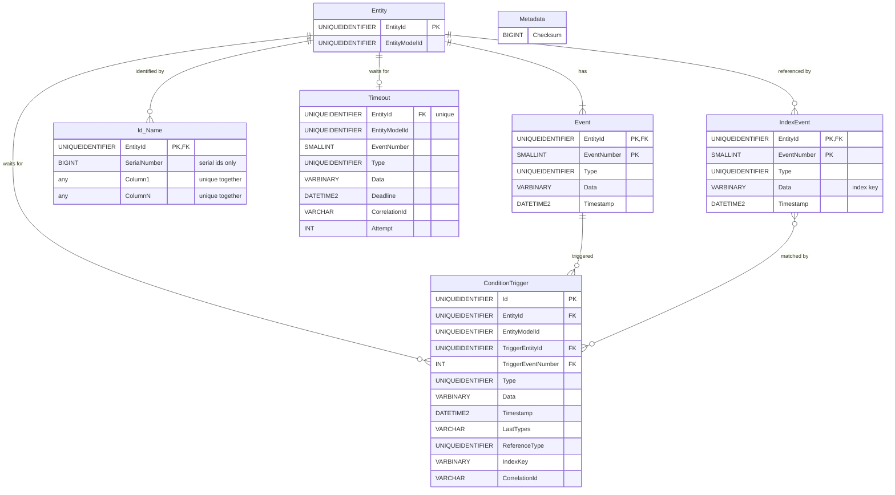

# Data model

The state machine stores everything in a single Microsoft SQL Server schema, which it creates on startup (see
`CreateSchema`). Entities are event sourced: the current state of an entity is derived by replaying its events, so the
event log is the source of truth and the other tables hold identifiers and pending work.

The relationships are logical only; the schema declares no foreign key constraints. All changes caused by a single
input event (new events, identifiers, timeouts and condition triggers, possibly on several entities) are written in one
transaction.

## Tables

### Metadata

A single row with a checksum of the schema's identifier tables. On startup the checksum is compared with one computed
from the configured entity models, and startup fails if they differ, as the schema is never migrated automatically.

### Entity

One row per entity, inserted together with the entity's first event. `EntityModelId` is the id of the entity model the
entity is an instance of, which determines its states and transitions.

### Event

The event log. Each event belongs to an entity and is numbered from 1 within it, so the primary key
`(EntityId, EventNumber)` also guards against concurrent changes to the same entity: two transitions computed from the
same state both try to insert the same event number, and only one of them succeeds.

`Type` is the id of the event type, and `Data` is the event's data as marshalled by the event type's data type.

### IndexEvent

The event log of index entities (`IndexEntityModel`). An index entity shares its id with the entity it indexes, and
its events are reference events whose `Data` is an index key, such as the id of a customer that an order belongs to.
This makes it possible to find all entities referenced by a given key and reference event type (`EntitiesByIndex`),
which is what condition triggers are evaluated against. Index entities have no row in `Entity`.

`Data` is limited to 1700 bytes so that it can be indexed.

### Id_*Name*

One table per secondary identifier model (`SecondaryIdModel`), named after the model, such as `Id_MerchantId`. The
columns are defined by the model, and are unique together, so an identifier refers to at most one entity. An entity
has at most one identifier of each model. The tables are used to look up entities by an identifier other than their
entity id (`EventsByLookupId`).

Serial identifiers have a `SerialNumber` column. Identifiers in a group, such as batch numbers per merchant, are looked
up by group to find the last entity in the group (`EventsByLastEntity`) and to find the next identifier to allocate
(`LastSecondaryId`).

### Timeout

Delayed events, at most one per entity. A row is inserted when a transition schedules an event to happen after a delay.
`EventNumber` is the number the delayed event will get, so the timeout only fires if the entity has had no other event
since it was scheduled.

A worker polls for rows with a passed `Deadline` (`NextDeadline`). Before processing a row, it moves the deadline
forward using exponential backoff and increments `Attempt`, so that the event is retried if processing fails. Rows whose
event number no longer follows the entity's last event are deleted instead of fired (`DeleteExpiredDeadline`).

### ConditionTrigger

Events waiting for a condition on other entities. A row is inserted when a transition triggers an event on the entity
`EntityId` on condition that the entities referenced by `IndexKey` with reference event type `ReferenceType` (see
[IndexEvent](#indexevent)) all have a last event of one of the types in `LastTypes`, a comma separated list of event
type ids. `TriggerEntityId` and `TriggerEventNumber` identify the event whose transition created the trigger.

The trigger is fired right away if the condition is already met, and otherwise by a worker polling for triggers whose
condition is met (`ConditionTriggers`). The row is deleted in the same transaction as the event it fires is inserted.
