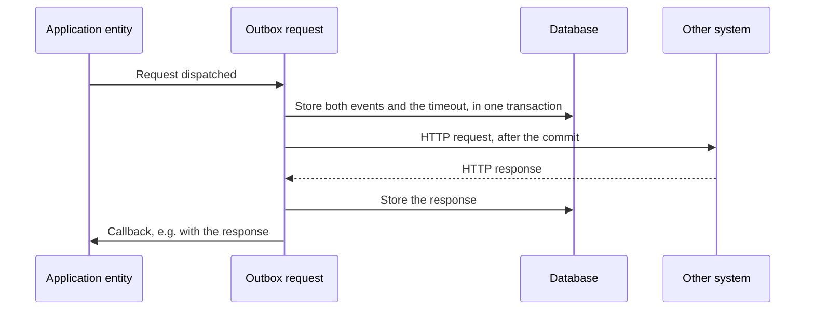
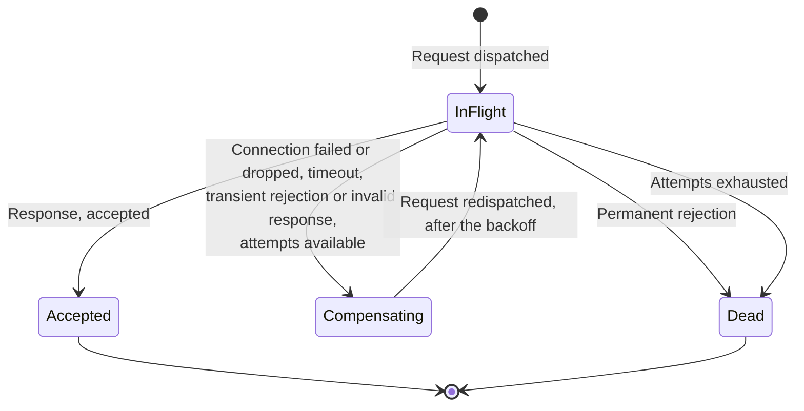
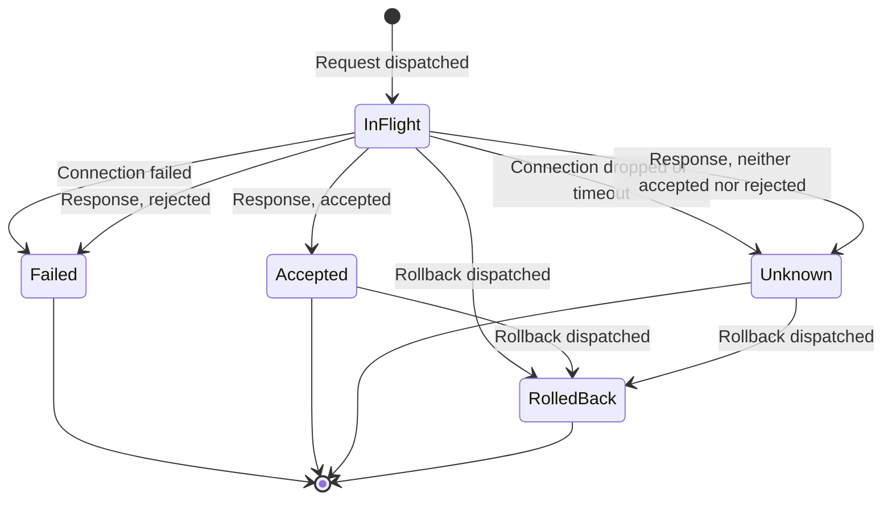

# HTTP outboxes

An application sends requests to other systems through outboxes. An outbox is an entity model whose entities are the
requests sent, so every request has a state and an event log of its own, stored in the same database as the entities
of the application.

An outbox delivers its requests either at least once (`AtLeastOnce`) or at most once (`AtMostOnce`). Which one fits
depends on what the receiver can tolerate: a duplicate, or not knowing whether the request arrived.

## The transactional outbox pattern

A transition sending a request to another system has two things to do: store the new state of the entity, and send
the request. They can't be done atomically, since the database and the other system don't share a transaction:

* If the request is sent first and the transaction then fails, the other system has acted on a request the
  application has no record of.
* If the transaction is committed first and the instance then stops before sending, the application believes it
  has sent a request which never left.

The transactional outbox pattern solves this by storing the request in the database, in the same transaction as the
change causing it, and sending it afterwards. The state machine does this for every outbox request:

1. The transition of the application triggers `Request dispatched` on a new entity of the outbox, with the request
   message as data. The outbox request is stored in the same transaction as the event of the application. If the
   transaction fails, nothing is sent.
2. The same transaction stores a delayed trigger, `TimeoutExpired`, after the inflight timeout of the outbox, and
   the action sending the request.
3. After the transaction is committed, the action sends the request. Its outcome, a response or a failure to
   connect, is fed back to the outbox request as an event, in a transaction of its own.
4. The outbox request triggers an event on the entity which dispatched it, e.g. with the response.



Since the request is stored before it is sent, the application always knows which requests it has started. What it
can't know is whether a request whose response never came was received: the instance may have stopped before
sending it, the connection may have broken, or the other system may have handled it without the response getting
back. In all these cases the delayed `TimeoutExpired` is fired, by any instance, and moves the request on. What happens
next is the delivery semantics of the outbox.

## Delivery semantics

| Outbox        | A request whose outcome is unknown is | The receiver must                    | Failures are handled by                         |
|---------------|---------------------------------------|--------------------------------------|-------------------------------------------------|
| `AtLeastOnce` | Sent again, after a backoff           | Tolerate duplicates, e.g. by an id   | Retrying until the attempts run out             |
| `AtMostOnce`  | Never sent again                      | Nothing                              | The application, e.g. by rolling the request back |

`AtLeastOnce` fits requests that are idempotent at the receiver, such as notifications carrying a message id, and
rollbacks. `AtMostOnce` fits requests that must not be repeated, such as authorising a card payment, where a duplicate
would reserve the amount twice. The outcome of an `AtMostOnce` request can be left unknown; the application then
decides what to do, e.g. roll the request back by a reversal, which is itself sent `AtLeastOnce`.

## AtLeastOnce

An `AtLeastOnce` request is sent again after a backoff when it has no response, or a response the receiver may give a
different answer to on a new attempt, until it is accepted or its attempts run out:



| State          | Meaning                                                                                            |
|----------------|----------------------------------------------------------------------------------------------------|
| `InFlight`     | The request is sent, or about to be, and waits for its response                                    |
| `Compensating` | The attempt failed, and the request will be sent again after the backoff                           |
| `Accepted`     | The receiver accepted the request. The process is told by the success callback, if there is one   |
| `Dead`         | The receiver rejected the request permanently, or the attempts ran out                             |

The response is parsed by the content parser of the outbox, and the predicates of the outbox decide the outcome:

| Outcome of an attempt                       | Decided by                            | Next                                     |
|---------------------------------------------|---------------------------------------|------------------------------------------|
| A valid response, accepted                  | `isAccepted`                          | `Accepted`                               |
| A valid response, rejected transiently      | `isFailureTransient`                  | Retry                                    |
| A valid response, rejected permanently      | `isFailureTransient` is false         | `Dead`                                   |
| An invalid response, rejected transiently   | `isRejectedByInvalidResponse`, `isFailureByInvalidResponseTransient` | Retry     |
| An invalid response, rejected permanently   | `isRejectedByInvalidResponse`, `isFailureByInvalidResponseTransient` is false | `Dead` |
| An invalid response, not a rejection        | `isRejectedByInvalidResponse` is false | Retry                                   |
| Connection failed or dropped, or no response before the inflight timeout | | Retry                               |

A retry asks `isAttemptAvailable` with a `RetryContext` of when the request was dispatched, the time now and the number
of the attempt. If an attempt is available, `backoffAlgorithm` gives the delay until the request is sent again, by a
delayed trigger; otherwise the request is `Dead`. The repeated request is the original one, or what the
`repeatMessageCreator` makes of it, e.g. with a new timestamp. Like the first attempt, every repeated attempt has the
inflight timeout.

The diagram generated from the model shows every event, including the intermediate ones of the choices above:

<object data="../images/com.github.thxmasj.backend.http.outbox.AtLeastOnce.svg" type="image/svg+xml" width="100%"></object>

[Open the diagram in full size](images/com.github.thxmasj.backend.http.outbox.AtLeastOnce.svg)

### Example

A notification to a merchant, which the merchant deduplicates by its id, retried every 30 seconds for a day:

```java
AtLeastOnce<Notification> notification = HttpOutboxRequest.atLeastOnce()
    .requestPayloadType(DataType.json(Notification.class))
    .responsePayloadType(DataType.json(Receipt.class))
    .forwarder(httpClient)
    .inflightTimeout(Duration.ofSeconds(5))
    .contentParser(JsonResponseValidator.json(Receipt.class))
    .isAccepted(_ -> true)
    .isFailureTransient(response -> response.statusCode() >= 500)
    .isRejectedByInvalidResponse(d -> d.t1().statusCode() >= 400)
    .isFailureByInvalidResponseTransient(d -> d.t1().statusCode() >= 500)
    .isAttemptAvailable(retry -> retry.now().isBefore(retry.enqueueTime().plusDays(1)))
    .backoffAlgorithm(_ -> Duration.ofSeconds(30))
    .build("MerchantNotification", notificationId);
```

## AtMostOnce

An `AtMostOnce` request is sent once. If its outcome is unknown, it stays unknown, and the application is told so:



| State        | Meaning                                                                                                   |
|--------------|-----------------------------------------------------------------------------------------------------------|
| `InFlight`   | The request is sent, or about to be, and waits for its response                                           |
| `Accepted`   | The receiver accepted the request                                                                         |
| `Failed`     | The request was not handled: the connection failed before it was sent, or the receiver rejected it      |
| `Unknown`    | The request may or may not have been handled: no response came, or the response doesn't tell             |
| `RolledBack` | A rollback request is dispatched, to undo the request if it was handled                                   |

A connection that fails is safe to treat as a failure, since the request never reached the receiver. A connection
that drops, or a response that doesn't come before the inflight timeout, is not: the receiver may have handled it.

Every outcome has a callback, an event triggered on the entity of the process which dispatched the request:

| Outcome                                    | Decided by                            | State      | Callback                   | Default             |
|--------------------------------------------|---------------------------------------|------------|----------------------------|---------------------|
| Connection failed                          |                                       | `Failed`   | `onPeerUnavailable`        | `ServiceFoundUnavailable` |
| Connection dropped, or the timeout expired |                                       | `Unknown`  | `onMissingResponse`        | `TimeoutExpired`    |
| A valid response, accepted                 | `isAccepted`                          | `Accepted` | `onSuccess`                | None                |
| A valid response, rejected                 | `isRejected`                          | `Failed`   | `onFailure`                | None                |
| A valid response, neither                  |                                       | `Unknown`  | `onValidResponseUnknown`   | None                |
| An invalid response, rejected              | `isRejectedByInvalidResponse`         | `Failed`   | `onInvalidResponseRejection` | `InvalidResponseReceived` |
| An invalid response, not a rejection       |                                       | `Unknown`  | `onInvalidResponseUnknown` | `InvalidResponseReceived`   |

### Rollback

An `AtMostOnce` request can have two rollback models, both `AtLeastOnce` outboxes: one for rolling back a request that
was accepted, and one for rolling back a request whose outcome is unknown, e.g. a reversal of a card authorisation.
The process rolls a request back by triggering `Rollback dispatched` on it, which moves it to `RolledBack` and
dispatches a request of the rollback model as a new entity. A request still `InFlight` is rolled back as one whose
outcome is unknown; its response, if it comes, is then ignored.

The rollback request message is created from the data `Rollback dispatched` is triggered with and the original
request, by the rollback message creator of the dispatcher (see [dispatching](#dispatching-a-request)). Since the
rollback model is `AtLeastOnce`, the receiver must tolerate a duplicate rollback, as well as a rollback of a request it
never received.

The diagram generated from the model, with both rollback models:

<object data="../images/com.github.thxmasj.backend.http.outbox.AtMostOnce.svg" type="image/svg+xml" width="100%"></object>

[Open the diagram in full size](images/com.github.thxmasj.backend.http.outbox.AtMostOnce.svg)

### Example

An authorisation of a card payment, reversed by an `AtLeastOnce` reversal if it is accepted or its outcome is unknown:

```java
AtMostOnce<AuthorisationRequest, ReversalRequest> authorisation = HttpOutboxRequest.atMostOnce()
    .requestPayloadType(DataType.json(AuthorisationRequest.class))
    .responsePayloadType(DataType.json(AcquirerResponse.class))
    .forwarder(httpClient)
    .processModel(Payment)
    .onMissingResponse(AuthorisationUnknown)
    .contentParser(JsonResponseValidator.json(AcquirerResponse.class))
    .onSuccess(AcquirerResponded, TypedHttpResponse::payload)
    .onFailure(AcquirerDeclined, TypedHttpResponse::payload)
    .isAccepted(response -> response.payload().approved())
    .isRejected(response -> !response.payload().approved())
    .isRejectedByInvalidResponse(_ -> false)
    .rollbackOnAcceptedModel(reversal)
    .rollbackOnUnknownModel(reversal)
    .build("Authorisation", authorisationId);
```

## Dispatching a request

An outbox request doesn't create its request messages, so it can be used by any process. A dispatcher pairs it with
the creator of its request message, from data of the transition dispatching it:

| Dispatcher                                | Outbox                    | Input of the request                        |
|-------------------------------------------|---------------------------|---------------------------------------------|
| `AtLeastOnceDispatcher`                   | `AtLeastOnce`             | The request message                         |
| `AtMostOnceDispatcher`                    | `AtMostOnce`, no rollback | The request message                         |
| `AtMostOnceWithRollbackDispatcher`        | `AtMostOnce`, rollback    | The request message                         |
| `BatchedAtLeastOnceDispatcher`            | `AtLeastOnce`             | The request message and the id of its batch |
| `BatchedAtMostOnceDispatcher`             | `AtMostOnce`, no rollback | The request message and the id of its batch |
| `BatchedAtMostOnceWithRollbackDispatcher` | `AtMostOnce`, rollback    | The request message and the id of its batch |

`of(...)` takes a function creating the request message from the data, and `reactive(...)` one creating it
reactively, from the data and the `DispatchContext` of the dispatching transition. A dispatcher with rollback also
takes the rollback message creator.

```java
var authorisations = AtMostOnceWithRollbackDispatcher.of(
    authorisation,
    (Authorisation a) -> TypedHttpRequest.create(POST, acquirerUri, new AuthorisationRequest(a)),
    (context, d) -> Mono.just(TypedHttpRequest.create(POST, reversalUri, new ReversalRequest(d.t2().payload())))
);
```

The transition dispatching the request triggers `requestDispatched()` of the dispatcher on a new entity of its outbox:

```java
onEvent(Authorise).to(Authorising)
    .assemble(c -> tuple(c.input(), DispatchContext.of(c)))
    .trigger(authorisations.requestDispatched())
    .withReactive(d -> authorisations.input(d.t2(), d.t1()))
    .on(authorisations.outbox())
    .identifiedBy(newEntityId())
    .output()
```

A process rolling the request back triggers `rollbackDispatched()` of the dispatcher on the entity of the request,
e.g. by the entity id it got back when it was dispatched.

The dispatcher has the transitions of the outbox, and of its rollback models, to register along with those of the
application:

```java
transitions.putAll(authorisations.transitions());
```

## Finding the requests of a process

Every request is indexed by the id of the entity which dispatched it, `ProcessReferenced`, and a batched request also
by the id of its batch, `BatchReferenced`. A process can thereby find its requests, and wait for all the requests of a
batch to complete by a conditional trigger on `HttpOutboxRequest.requestAccepted()`, which is the same event type for
every outbox.
