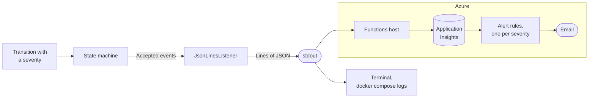

# Monitoring

An application is monitored by its events. A transition declares the severity of its event, the state machine reports
every event it accepts to its listener, and the listener of the apps writes each one as a line of JSON to stdout.
From there on it is up to the platform the application runs on, which collects the lines and raises alerts by their
severity. Locally that is the terminal, and on Azure it is Application Insights and Azure Monitor.



## Severity

The severity of an event tells how much attention it calls for:

| Severity   | Meaning                                                                               | Alert on Azure   |
|------------|---------------------------------------------------------------------------------------|------------------|
| `Info`     | The normal course of things. The default.                                             | None             |
| `Warning`  | Out of the ordinary, but handled. Worth a look if it keeps happening.                 | Sev 2 (warning)  |
| `Error`    | Something has failed, and is left for someone to sort out.                            | Sev 1 (error)    |
| `Critical` | Something has failed which can't wait to be sorted out.                               | Sev 0 (critical) |

It is declared on the transition accepting the event, after its state. The [identity provider](identity-provider.md)
warns of the token requests it refuses:

```java
onEvent(TokenRefused).to(States.Refused).severity(Severity.Warning)
    .assembleInput()
    .trigger(Inbox.ReplyCreated).with(Tokens::reply).on(RequestDispatching).identifiedBy(entityIdFromSession())
    .output(Tuple2::t1)
```

The severity belongs to the transition rather than to the event type, since the same event means different things
in different places. `Timeout expired` on an `AtLeastOnce` [outbox request](http-outbox.md) only leads to another
attempt, while on an `AtMostOnce` request it leaves the outcome unknown.

A transition which chooses another one [stores the event of the chosen
transition](transition-models.md#the-events-stored-for-a-choice), so that is where the severity goes. A failed
connection of an `AtLeastOnce` request is nothing to tell about as long as the request is sent again, but an error
when it is given up. In short, the outbox does this:

```java
onEvent(ConnectionFailed).to(Intermediate)
    .assemble(retry)
    .when(isAttemptAvailable).then(
        onEvent(RetryScheduled).to(Compensating)
            .assembleInput()
            .trigger(RequestRedispatched).after(backoff)
            .output(),
        d -> d
    )
    .otherwise(onEvent(AttemptsExhausted).to(Dead).severity(Severity.Error).output(), _ -> null)
```

The severity is not stored with the event. Changing the severity of a transition applies to the events accepted from
then on.

These transitions have a severity of their own:

| Model                                      | Events                                                    | Severity  |
|--------------------------------------------|-----------------------------------------------------------|-----------|
| `AtLeastOnce` [outbox requests](http-outbox.md#atleastonce) | The events leading to `Dead`: the attempts are exhausted, or the request is rejected permanently | `Error` |
| `RequestDispatching` of the [HTTP inbox](http-inbox.md) | `Failed request completed`, which responds 500 Internal Server Error | `Error` |
| `Token request` of the [identity provider](identity-provider.md) | `Token refused`, as many of them may be an attempt to guess a secret | `Warning` |
| `Authorization` of the [identity provider](identity-provider.md) | `Authorization refused`, for an unknown client or redirect URI, and `User authentication failed` | `Warning` |
| `Settlement` of the [card payment template](cardpayments.md) | `Imbalance detected` and `Settlement timed out`, which leave the settlement in `Error` | `Error` |

The [state diagrams](diagrams.md) show the severity of a transition in the colour of its event's name.

## The lines

The state machine reports to the `Listener` it is created with. `JsonLinesListener` writes the events to stdout:

```java
new StateMachine(null, transitions, dataSource, null, schema, null, Clock.systemUTC(), new JsonLinesListener());
```

Every accepted event is a line of JSON, here an outbox request which is given up:

```json
{"time":"2026-11-13T12:00:00.123Z","severity":"ERROR","message":"Attempts exhausted on MerchantNotification 9f0c5a2e-1b3d-4c5e-8f7a-6b5c4d3e2f1a","entityModel":"MerchantNotification","entityId":"9f0c5a2e-1b3d-4c5e-8f7a-6b5c4d3e2f1a","eventNumber":7,"eventType":"Attempts exhausted","correlationId":"SYS-4117038264571339210"}
```

| Field           | Description                                                                     |
|-----------------|---------------------------------------------------------------------------------|
| `time`          | The time of the event, in UTC                                                   |
| `severity`      | `INFO`, `WARNING`, `ERROR` or `CRITICAL`                                        |
| `message`       | The event in words                                                              |
| `entityModel`   | The name of the entity model                                                    |
| `entityId`      | The id of the entity                                                            |
| `eventNumber`   | The number of the event in the event log of the entity                          |
| `eventType`     | The name of the event type                                                      |
| `correlationId` | The correlation id of what led to the event, e.g. of the request to the [HTTP inbox](http-inbox.md) |

* **The data of the events is not written**, as it may be sensitive. The event log has it, and the entity model,
  entity id and event number of a line find the event there.
* **Events are written when they have happened.** Delayed events and conditional triggers are not written when they
  are stored, but as events when they fire. Read-only events are written too, though they are not stored, so the
  event log does not have them.
* **The events of a transaction are written together**, after it is committed, with those of an entity in the order
  of their numbers. They are written whether or not the one who triggered them still waits for them.
* **A failure to process a delayed trigger** is written as a line of severity `ERROR` with only `time`, `severity`
  and `message`, as there is no event to tell about. The message is the failure as it is, which may have data, e.g.
  the parameters of a query which failed. The worker tries again. No other failure is written, see the
  [limits](#limits).
* **The other output can't pass for events.** The debug output of the libraries goes to stdout as well (see the
  [gaps](hello-world.md#logs) of the demo), and it has data which anyone can send, such as whole requests. So that no
  such data makes up a line of its own, every line after the first of a text is marked with `  | `. An application
  writing to stdout itself has to take the same care.

To send the events somewhere else, implement `Listener`, whose methods do nothing unless they are implemented.

## Running locally

The lines are in the output of the process, among the debug output. With the apps running under Compose, this follows
the events which call for attention, as `2026-11-13T12:00:00.123Z ERROR Attempts exhausted on MerchantNotification
9f0c5a2e-...`:

```shell
docker compose logs --follow --no-log-prefix app \
  | jq -Rr 'fromjson? | objects | select(.severity != null and .severity != "INFO") | "\(.time) \(.severity) \(.message)"'
```

`fromjson?` skips the lines which are not JSON. Leave out `and .severity != "INFO"` to follow every event.

## On Azure

The [deployment to Azure Functions](azure-functions.md) sets up the collection of the lines and the alerts on them.
Nothing in the application is specific to Azure.

### Collection

The Functions host logs every line the application writes to stdout as a trace in Application Insights, which keeps
them in its Log Analytics workspace for 30 days. A line is there within a few minutes.

By default the host samples the telemetry of an instance which sends more than 20 items a second, and would then drop
most lines, those of events included. A single request to the hello world demo writes about 70 lines, of which 6 are
events, so that takes less than a request a second. The deployment therefore excludes traces from sampling, in the
`host.json` of the deployment package, and every line is collected.

### Alerts

Each of the severities `Warning`, `Error` and `Critical` has a
[log search alert rule](https://learn.microsoft.com/azure/azure-monitor/alerts/alerts-types#log-alerts) in
Azure Monitor, with the corresponding severity there. A rule counts the lines of its severity every 15 minutes:

* **An alert is fired for each entity model and event type** with events in the period, so the alert tells what
  happened to what. Its query finds the events themselves, with their entity ids and correlation ids.
* **An alert does not resolve by itself**, as its events have happened for good. It stays fired until someone closes
  it. More events in a later period fire a new alert.
* **An alert is fired some minutes after its event:** the minutes Application Insights takes to collect the line,
  and then up to the period of the rule.
* **A failure to process a delayed trigger fires the alert of `Error`** too, with `-` for its entity model and event
  type.

The fired alerts are listed under **Monitor** > **Alerts** in the Azure portal, and on the Application Insights
resource of the application. To have them sent by email as well, give the addresses, and deploy:

```shell
pulumi config set --path 'alertEmails[0]' operations@example.com
pulumi up
```

`alertFrequency` sets the minutes between the evaluations of the rules, which is also the period each evaluation looks
at, so an event is counted once. Azure Monitor accepts 1, 5, 10 and 15, among others, and `0` leaves out the rules
altogether. A frequency of 1 has
[limitations](https://learn.microsoft.com/azure/azure-monitor/alerts/alerts-create-log-alert-rule#configure-alert-rule-conditions)
of its own, one being that there must be traces already, which a new deployment has not.

### Finding the events

The events, with the latest hour here, are queried with the Azure CLI:

```shell
az monitor app-insights query \
  --app "$(az monitor app-insights component show --resource-group "$(pulumi stack output resourceGroupName)" --query "[0].appId" --output tsv)" \
  --analytics-query 'traces | where timestamp > ago(1h) and message startswith "{" | extend line = parse_json(message) | where isnotempty(line.severity) | project timestamp, severity = tostring(line.severity), event = tostring(line.message), correlationId = tostring(line.correlationId) | order by timestamp asc' \
  --output table
```

### Costs

The prices are those of Sweden Central in November 2026, from the
[pricing of Azure Monitor](https://azure.microsoft.com/pricing/details/monitor/):

| What                                                | Price                                                                  |
|-----------------------------------------------------|------------------------------------------------------------------------|
| An alert rule evaluated every 15, 10, 5 or 1 minutes | USD 0.50, 1.00, 1.50 or 3.00 a month. The three rules are USD 1.50 a month at the default frequency. |
| Each entity model and event type a rule fires alerts for, after its first | USD 0.05, 0.10, 0.15 or 0.30 a month, by the frequency |
| Emails                                              | The first 1,000 a month are free                                       |
| Collected lines                                     | USD 2.99 per GB. The first 5 GB a month of a billing account are free. |

The rules cost the same whether the application runs or not. The lines are what grows with the traffic, and nine out
of ten are debug output, which can't be turned off yet
([#216](https://github.com/the-backend-project/tits/issues/216)). As the traces are not sampled, all of it is
collected, so keep an eye on the size of the logs of an application with more than a little traffic.

### Limits

* **The alerts are only as good as the severities.** An event of a transition with no severity is `Info`, and raises
  nothing.
* **Only events are monitored**, and the failures to process a delayed trigger. Other failures raise no alert
  ([#216](https://github.com/the-backend-project/tits/issues/216)). A request failing without an event, e.g. on an
  exception, is answered with 500 by the HTTP inbox listener and is among the `requests` of Application Insights. A
  failure of the work in the background is in the debug output at best: a conditional trigger failing to fire, an
  action failing, or the event an action results in failing to be processed. The same goes for a delayed trigger
  which can't be read from the database, e.g. as its event type is no longer in the code.
* **Background work stops when the app scales to zero**, see the [limitations](azure-functions.md#limitations) of
  the deployment. Its events, and their alerts, wait with it.
* **Azure Monitor disables a rule which keeps failing.** The query of a rule
  [fails](https://learn.microsoft.com/azure/azure-monitor/alerts/alerts-troubleshoot-log#a-log-search-alert-didnt-fire-when-it-should-have)
  when its table has had no data for more than 30 days, and a rule which has failed for a week is disabled. An
  application writes nothing while it is scaled to zero, so after some five weeks without use its rules may be
  disabled, and they stay so when it is used again. The **Resource health** of a rule in the Azure portal tells how
  it is doing, and `pulumi up --refresh` enables the rules again.

## Other platforms

The lines are made for the log collectors of other platforms as well: one JSON object per line on stdout, with the
severity, message and time in the fields `severity`, `message` and `time`. Google Cloud Logging reads these fields
of a line as the severity, text and timestamp of its log entry, and a metric filter of Amazon CloudWatch Logs matches
on them, e.g. `{ $.severity = "ERROR" }`. Only Azure has its alerts set up by a deployment here.
