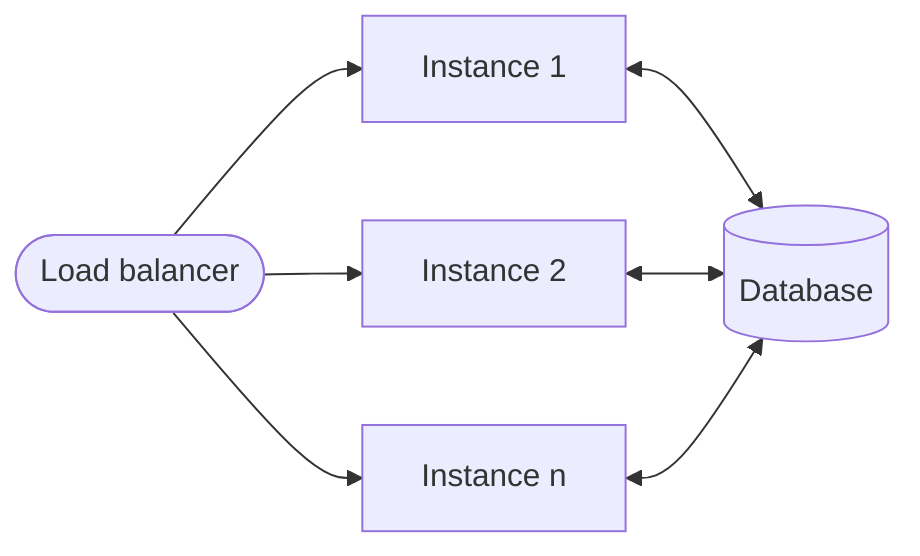

# Scaling

The transaction server scales horizontally, because its instances are stateless, and vertically, because its code is
reactive. An application handles more load by running more instances, and each instance handles many requests at
once with few threads.

## Horizontally: stateless instances

An instance keeps no state in memory between requests. Everything an entity is, its [event log](entities.md), its
delayed and conditional triggers, and the [requests received and sent](architecture.md) for it, is in the database.
Every instance can therefore handle every request, and any number of instances can serve the same database, behind
any load balancer, with no sticky sessions and no coordination between them.

The instances don't lock entities or elect a leader. They are kept consistent by the database:

* **Concurrent events on an entity.** Two instances may process events on the same entity at once. Both read its event
  log and take a transition from its current state, but only one can store the next event number. The transaction of
  the other fails, and its event is [processed again](entities.md#processing-an-event) from the new state. The
  transition is taken again from that state, so it is never taken from a stale one.
* **Delayed triggers.** Every instance runs a worker that polls for due [delayed triggers](data-model.md#delayedtrigger).
  A worker claims a trigger by moving its deadline forward in the same statement it finds it with, so two workers
  don't fire the same trigger at once. On PostgreSQL the statement skips rows locked by other workers
  (`FOR UPDATE SKIP LOCKED`), and on SQL Server it updates the row only if its deadline is still the one it found. If
  the instance stops before the trigger is fired, the moved deadline passes and any instance fires it. A trigger whose
  entity has had another event in the meantime is deleted instead.
* **Conditional triggers.** Every instance also runs a worker that fires the
  [conditional triggers](data-model.md#conditionaltrigger) whose conditions are met. A conditional trigger is deleted
  in the transaction of the event it fires, so if two instances fire it at once, only one of them stores the event.
* **Actions.** An action, such as an [outbox](http-outbox.md) request, is run by the instance that committed the
  transaction it was triggered in. A delayed trigger stored in the same transaction, such as the outbox's inflight
  timeout, moves the entity on if that instance stops before the action completes, and it can be fired by any
  instance.

The workers can be turned off for an instance (`withResolving` set to `false` in the constructor of `StateMachine`),
e.g. to serve requests only, as long as some instance runs them.

Instances can be added and removed at any time, and stopped in the middle of their work. Since the side effects of an
event only happen after the event is stored, a stopped instance leaves nothing behind that another instance can't
pick up. This is also what lets an application [scale to zero](azure-functions.md), with the caveat that background
work waits until an instance runs again.

The limit of horizontal scaling is the database: every instance shares it, and every event is a transaction in it.
Events on different entities don't contend with each other, but events on the same entity are serialised by its event
numbers, so many concurrent events on one entity lead to retries.

## Vertically: reactive code

The transaction server is built on [Reactor](https://projectreactor.io) from end to end. The [HTTP inboxes](http-inbox.md)
and [outboxes](http-outbox.md) use Reactor Netty, and the processing of an event is a chain of non-blocking steps.
No thread waits for the database or for another system: while a request is waiting, its thread is handling other
requests. An instance therefore handles many concurrent requests on a few event loop threads, and adding CPU cores
or memory to an instance lets it handle more of them, rather than being limited by the number of threads.

How queries reach the database depends on the [database module](databases.md#threads):

* The reactive modules, **database-pgsql-r2dbc** and **database-pgsql-vertx**, don't block. The queries run on event
  loop threads.
* The JDBC modules, **database-mssql** and **database-pgsql-jdbc**, block, but each query runs on a virtual thread of
  its own. A blocked virtual thread doesn't hold an operating system thread, so the blocking doesn't limit how many
  queries are in flight.

In both cases the number of concurrent queries is bounded by the connection pool, not by threads. The size of the pool
should match what the database can handle, divided among the instances sharing it.
