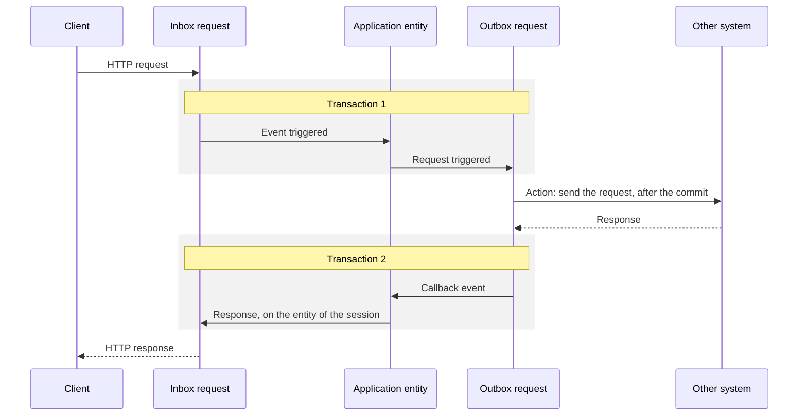

# Sessions, transactions and transitions

The state machine processes events in three units of work, each made of one or more of the next. A session is
one or more transactions, and a transaction stores one or more transitions.

| Unit       | What it is                                                                                       | What it guarantees                                    |
|------------|--------------------------------------------------------------------------------------------------|-------------------------------------------------------|
| Transition | An entity going from one state to the next on an event                                           | It is only calculated; it has no side effects         |
| Transaction | Everything one event leads to, across all the entities involved, stored in the database          | All of it is stored or none of it is                  |
| Session    | The transactions an event leads to through actions, such as a request to another system         | Its transactions share the session's entity and caller, but not atomicity |

## Transitions

A [transition model](transition-models.md) takes an entity of its [entity model](entities.md) from a state to the
next on an event type. Taking it calculates the new event of the entity, and the triggers it declares, from the event
log of the entity and the data of the event. Nothing is stored and nothing is sent while it is calculated.

A transition triggering an event on another entity (an event trigger) continues with the transition of that entity,
nested in its own, and that one may trigger events on yet other entities in turn. The transitions an event leads to
this way form one calculation: a chain of steps, from the input step of the first transition to its output step,
with the steps of the nested transitions in between (see [Steps](transition-models.md#steps)).

## Transactions

When the calculation is done, its changes are [collected](transition-models.md#collecting-the-changes) from the chain
and stored in one database transaction:

* the new events of every entity involved,
* the delayed triggers (`after(..)`), such as timeouts,
* the conditional triggers.

Either all of them are stored or none of them are. If another instance has appended an event to one of the
entities in the meantime, the transaction fails on the event number, and the calculation is done again from the new
event logs (see [Processing an event](entities.md#processing-an-event)). So is it if an id the calculation claims is
found to be taken (see [Existing ids](existing-ids.md)).

The actions of the transitions, such as sending an [outbox request](http-outbox.md), are run only after the
transaction is committed, and delayed and conditional triggers are fired by a worker once they are due. What happens
then is processed as a new event, in a transaction of its own.

## Sessions

A session starts with an event entering the state machine through `StateMachine.onEvent`, such as a request received
by an [HTTP inbox](http-inbox.md). It is the transaction storing what that event leads to, and the transactions of
the outcomes of its actions, such as the response to an outbox request. The outcome of an action is processed as a
new event, in a transaction of its own, on the entity whose transition ran the action. Its transaction is part of the
session, and can:

* **Find the entity of the session.** An event triggered on the entity identified by the session
  (`entityIdFromSession()`) goes to the entity of the trigger's entity model that a transition of the session was
  taken on. For an `EntityModelGroup`, such as `HttpInbox.Request`, it is the entity of the model in the group, and
  the session is the only way to identify it. That is how an application responds to the
  [inbox request](http-inbox.md) it was called from, e.g. from the callback of an outbox request, without knowing
  which inbox request that is.
* **Reach the caller.** `StateMachine.onEvent` returns the events of the entity it was called on, as they are stored.
  The events of that entity stored by later transactions of the session are returned as well, which is how the
  `HttpInboxListener` gets a response given after a request to another system.

A session gives no atomicity across its transactions. Each one is committed on its own, and a failure in a later one
doesn't undo the ones before it. That is why the entities involved record what they have started, and why an outbox
request stores a timeout in the transaction sending it (see [HTTP outboxes](http-outbox.md)).

Delayed and conditional triggers start a session of their own when they fire. They keep the correlation id of the
transaction storing them, but neither its entity nor its caller.

An inbox request whose application calls another system has one session of two transactions, each with
several transitions:

### How far a session reaches

The entity of the session is found among the entities of the current transaction and of the transaction that ran the
action, but not further back. A response triggered on the session after two actions in a row, e.g. after a request to
one system and then to another, fails, and the caller waits until it times out. Until that is fixed
([#308](https://github.com/the-backend-project/backend/issues/308)), respond to an inbox request from the transaction
of the first action's outcome, and identify any other entity of the session by its id.
