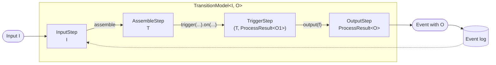
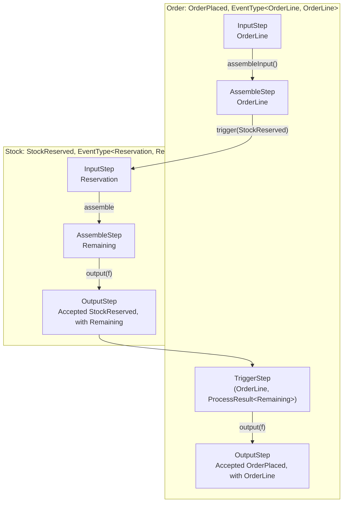
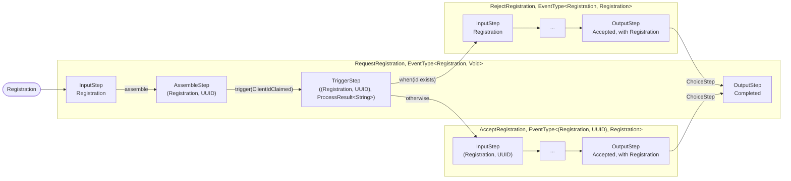

# Transition models

## Input and output of an event type

An event type has two type parameters, `EventType<I, O>`, and so does the transition model of a transition on it,
`TransitionModel<I, O>`:

* **`I`, the input**, is the data an event of the type is triggered with: by `with(...)` of the transition triggering
  it, by the caller of `StateMachine.onEvent`, or by a delayed or conditional trigger, which stores it until the
  trigger fires. The transition calculates its event from it.
* **`O`, the output**, is the data of the event the transition stores in the entity's event log. `output(f)` calculates
  it from the data of the last step, and `output()` stores the event without data. The output is also what a
  transition triggering the event gets back.

`BasicEventType.of(name, id, dataType)` gives an event type whose input and output are the same, and
`BasicEventType.of(name, id)` one with neither (`Void`). The [identity provider](identity-provider.md) has event types
of all kinds:

| Event type              | `I`                    | `O`            |
|-------------------------|------------------------|----------------|
| `ClientRegistered`      | `Registration`         | `Registration` |
| `RegistrationRequested` | `Registration`         | `Void`         |
| `RegistrationAccepted`  | `(Registration, UUID)` | `Registration` |
| `ClientIdClaimed`       | `String`               | `String`       |

## Steps

`TransitionModelBuilder` builds the transition model. It starts with `onEvent(type).to(state)`, every call after it,
such as `assemble`, `trigger` or `when`, adds a step, and `output()` ends it with the model.

When an event enters an entity, the model calculates the steps of the transition one by one, each from the one before
it. A step is a `TransitionStep<T>`, where `T` is its output: the data the next step is calculated from. The chain
starts with an `InputStep`, whose output is the input `I`, and ends with an `OutputStep`, whose output is the result of
the transition, a `ProcessResult<O>` with the new event if it is accepted. The steps in between turn one into the
other:



The input step also has what the other steps need besides the data: the entity's event log, its current state, the
timestamp, and the `Calculation` the step is part of. The output of each step is:

| Step                     | Added by                      | Output                                                                                        |
|--------------------------|-------------------------------|-----------------------------------------------------------------------------------------------|
| `InputStep`              | The event entering the entity | The input `I`                                                                                 |
| `AssembleStep`           | `assemble`                    | What the assembler makes of the input and the event log                                       |
| `TriggerStep`            | `trigger(...).on(...)`        | The output of the step before it, paired with the `ProcessResult<O1>` of the event triggered  |
| `DelayedTriggerStep`     | `trigger(...).after(...)`     | The output of the step before it. The step has the delayed event to store                     |
| `ConditionalTriggerStep` | `trigger(...).when(...)`      | The output of the step before it. The step has the conditional trigger to store               |
| `ActionStep`             | `trigger(action)`             | The output of the step before it. The step has the action to run after the changes are stored |
| `ChoiceStep`             | `when(...).then(...)`         | The output of the step before it, after the steps of the chosen transition                    |
| `OutputStep`             | `output`                      | The `ProcessResult<O>` of the transition                                                      |

## Triggering an event on another entity

An event triggered on another entity continues the chain into the transition of that entity. The data of the trigger,
`with(...)`, is the input `I1` of the triggered event type, and becomes the output of the `InputStep` of the triggered
transition. Its steps follow up to its `OutputStep`, whose `ProcessResult<O1>` the `TriggerStep` pairs with the data
it had before the trigger, and the chain goes on in the triggering transition.

An order reserving the items of an order line from their stock shows how the data goes from one entity to the
other. `OrderPlaced` takes the order line as input and stores it as output, and `StockReserved` takes the quantity to reserve as
input and stores the quantity left in stock as output:

```java
record OrderLine(UUID item, int quantity) {}
record Reservation(int quantity) {}
record Remaining(int quantity) {}

EventType<OrderLine, OrderLine> OrderPlaced = BasicEventType.of("Order placed", placeId, DataType.json(OrderLine.class));
EventType<Reservation, Remaining> StockReserved = BasicEventType.of(
    "Stock reserved",
    reserveId,
    DataType.json(Reservation.class),
    DataType.json(Remaining.class)
);
```

The transition of the order triggers `StockReserved` on the stock of the item, and the transition of the stock calculates
the quantity left from its event log:

```java
onEvent(OrderPlaced).to(OrderStates.Placed)
    .assembleInput()
    .trigger(StockReserved).with(line -> new Reservation(line.quantity())).on(Stock).identifiedBy(line -> entityId(line.item()))
    .output(d -> d.t1())

onEvent(StockReserved).toSelf()
    .assemble((reservation, log) -> new Remaining(remaining(log) - reservation.quantity()))
    .output(remaining -> remaining)
```



Every step refers to the one before it, `previous`, so the steps of both transitions are stacked in one chain, with
the steps of the triggered transition nested between the step triggering it and the `TriggerStep`. Below, the first
step is on top, every step refers to the one above it, and the result of the calculation is the step at the bottom:

<div class="step-stack">
  <div class="step-stack-title">Order: OrderPlaced</div>
  <div class="step"><code>Input</code><span>OrderLine</span></div>
  <div class="step"><code>Assemble</code><span>OrderLine</span></div>
  <div class="step-stack">
    <div class="step-stack-title">Stock: StockReserved</div>
    <div class="step"><code>Input</code><span>Reservation</span></div>
    <div class="step"><code>Assemble</code><span>Remaining</span></div>
    <div class="step"><code>Output</code><span>ProcessResult&lt;Remaining&gt;</span></div>
  </div>
  <div class="step"><code>Trigger</code><span>(OrderLine, ProcessResult&lt;Remaining&gt;)</span></div>
  <div class="step"><code>Output</code><span>ProcessResult&lt;OrderLine&gt;</span></div>
</div>

The `TriggerStep` also refers to the step before the trigger, `outer`, here the `AssembleStep` of `OrderPlaced`, whose
output it pairs with the result of the triggered event. A step finds the `InputStep` of its own transition, with the
event log and the timestamp, by skipping over the nested transitions, from their `OutputStep` back to their
`InputStep`.

A triggered event isn't always accepted. Instead of an `OutputStep`, the triggered transition can then end with one
of these, whose `ProcessResult` the triggering transition can act on, e.g. with `when(...)`:

| Step            | When                                                                                |
|-----------------|-------------------------------------------------------------------------------------|
| `RejectedStep`  | The event is rejected, e.g. since the entity has no transition on it from its state |
| `UnknownIdStep` | The entity of the event is not found                                                |
| `PendingStep`   | The event is circular, i.e. on an entity already changed by the calculation         |
| `IdExistsStep`  | The id of an id event is held by another entity (see [existing ids](existing-ids.md)) |

## Choosing a transition

`when(predicate).then(model, f)` chooses another transition of the same entity, if the predicate holds for the
output of the step before it. `f` gives the input of the chosen transition's event type, and the steps of the chosen
transition follow, in the chain, up to its `OutputStep`. `otherwise(model, f)` ends the transition with the
transition chosen if no other one was. The event of the chosen transition is then the event stored; the output of the
transition itself is a `Completed` result referring to it.

The identity provider registers a client by `RegistrationRequested`, whose output is `Void`, and the event stored is
either `RegistrationRejected` or `RegistrationAccepted`, depending on whether the client id is taken:



### The events stored for a choice

Only the event of the chosen transition is stored in the entity's event log. The event of the transition making the
choice is not, and neither is its input. The log of a client has `RegistrationAccepted` or `RegistrationRejected`, but
never `RegistrationRequested`. A chosen transition can make a choice too, and then the event stored is the one of the
last transition chosen. The changes of the steps before the choice are still stored, e.g. the `ClientIdClaimed` event
triggered on another entity above.

The current state of an entity is not stored either. It is found again from the log each time, by following the
transitions of the stored events from `Begin`. A stored event may be the result of a choice, so for each state, the
event types of the transitions from it are looked up with the choices expanded, i.e. as the event types of the
transitions they can choose. That has these consequences:

* **The state after a choice is the state of the chosen transition.** `RegistrationRequested` goes `to(States.Accepted)`,
  but that state is never used, since its event is never stored. A rejected registration ends in `States.Rejected`, the
  state of `RegistrationRejected`. A chosen transition with `toSelf()` stays in the state the choosing transition
  started from.
* **The path to a stored event must be unique.** From any state, an event type in the log has to lead to a single
  transition, whether it is a transition from that state or one chosen, at any depth, by a transition from that state.
  If two transitions from a state, or two branches of one choice, choose different transitions on the same event type,
  e.g. two `RegistrationRejected` transitions going to different states, or a transition from the state chooses a
  transition on an event type that another transition from the state is on directly, the log doesn't tell which path
  was taken. The first transition found is used, and the entity may end up
  in the wrong state. Give the transitions their own event types instead.
* **Rolling back uses the chosen transition.** The reverse model of a stored event is found in the same way, so it is
  the reverse model of the chosen transition that rolls the event back, not the one of the transition making the
  choice.
* **What the outcome needs later must be in its output.** The input of the choosing event is lost when the choice is
  made, so data to read from the log later has to be in the output of the chosen transition, as the `Registration` in
  `RegistrationAccepted` above.

## Collecting the changes

When the calculation is done, the changes to store, i.e. the accepted events, the delayed events and the conditional
triggers, and the actions to run, are collected by following the chain back from its last step to its first. In the
order above, that gives the `OrderPlaced` and `StockReserved` events.

Every step is taken through the `Calculation` of the event, which records the result of the step. That makes it
possible to calculate the changes again from a step in the middle of the chain, without executing the steps before it
again, such as an assembler reading from another system.
